<!-- 1페이지 -->

# LLM

---

<!-- 2페이지 -->

## N-gram의 문제점

1. 데이터 희소성 → 단어 임베딩
2. 고정된 문맥 윈도우 → RNN/LSTM
3. 장거리 의존성 → 어텐션
4. 순차적 계산 병목 현상 → 트랜스포머
5. 대규모 사전 학습 → LLM

---

<!-- 3페이지 -->

# 창발적(Emergent) 능력

---

<!-- 4페이지 -->

## LLM의 창발적(Emergent) 능력

Jason Wei 외, 「대규모 언어 모델의 창발적 능력」(2022), arXiv:2206.07682v3.

### 창발적 능력

작은 모델에는 존재하지 않지만 큰 모델에는 존재하는 능력.

### 대규모 모델을 결정하는 세 가지 요소

- 연산량(학습 시간)
- 모델 파라미터 수(모델 크기)
- 학습 데이터셋 크기

창발이란 시스템의 양적 변화가 행동의 질적 변화로 이어지는 현상이다. (Steinhardt, 2022)

---

<!-- 5페이지 -->

### 퓨샷 프롬프팅(few-shot prompting) 환경에서 나타나는 창발 현상의 여덟 가지 예시

BIG-Bench, TruthfulQA, 근거 기반 개념 매핑, 다중 작업 언어 이해, 문맥 속 단어 등의 성능을 측정한다.

<p align="center">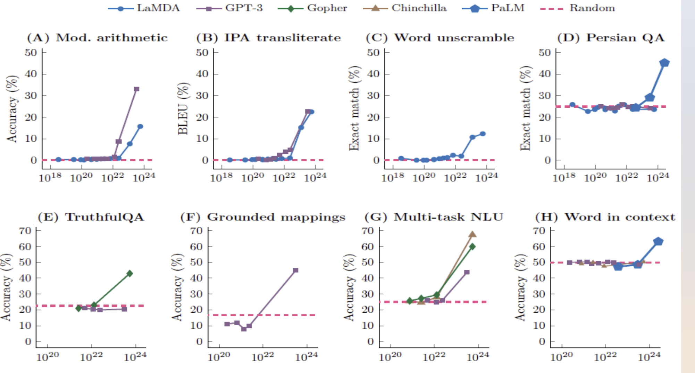</p>

---

<!-- 6페이지 -->

### 퓨샷 프롬프팅 작업 (Brown 외, 2020)

프롬프팅 패러다임에서 나타나는 창발적 능력의 한 종류.

1. 프롬프팅에서는 사전 학습된 언어 모델에 작업의 프롬프트(예: 자연어 지시문)를 제공하고, 파라미터에 대한 추가 학습이나 기울기 업데이트 없이 응답을 완성한다.

2. 퓨샷 프롬프팅은 모델이 추론 시점에 처음 보는 예시에 대해 작업을 수행하도록 요청하기 전에, 몇 개의 입력-출력 예시를 모델의 문맥(입력)에 서두로 포함한다.

---

<!-- 7페이지 -->

## 제로샷, 원샷, 퓨샷 학습

### 제로샷 학습

모델이 추론 과정에서 해당 작업의 예시를 전혀 보지 않고 작업을 수행한다.

```text
프롬프트: "이 영화는 너무 지루해"라는 문장의 감정을 분석해줘
GPT: 부정적인 감정입니다.
```

### 원샷 학습

모델이 작업을 수행하기 전에 학습에 참고할 단일 예시를 제공받는다.

```text
프롬프트: "그 영화는 너무 지루해" -> 부정적
"그 영화 심심했어" ->
GPT: 부정적
```

---

<!-- 8페이지 -->

## 범용 인공지능으로 이어지는 LLM의 창발적 능력

### 창발적 능력의 세 가지 유형

1. **문맥 내 학습(In-context learning)**: LLM이 추론 시점에 프롬프트에 제시된 소수의 예시로부터 새로운 작업을 학습한다. (제로샷, 원샷, 퓨샷)
2. **지시 이행(Instruction following)**: LLM이 명시적인 예시 없이도 새로운 유형의 작업에 대한 지시를 따를 수 있다. (지시 튜닝의 결과)
3. **다단계 추론(Multi-step reasoning)**: LLM이 복잡한 작업을 중간 추론 단계들로 나누어 해결할 수 있다.

외부 지식과 도구를 사용하여 LLM의 능력을 확장할 수 있다. 이를 통해 사용자 및 환경과 효과적으로 상호작용하고 스스로를 지속적으로 개선할 수 있다. (AI 에이전트 또는 LLM 기반 에이전트로 발전)

B. Peng 외, 「사실을 확인하고 다시 시도하라: 외부 지식과 자동화된 피드백을 통한 대규모 언어 모델 개선」, arXiv 사전 공개 논문 arXiv:2302.12813, 2023.

---

<!-- 9페이지 -->

# 토큰화(Tokenization)

---

<!-- 10페이지 -->

## 바이트 페어 인코딩(BPE, Byte Pair Encoding)

### BPE 이전

- **단어 수준 토큰화**: 모든 단어를 독립된 항목으로 취급한다. 이로 인해 어휘 집합의 크기가 매우 커지고, 어휘 집합에 없는 단어(OOV)나 철자가 틀린 단어를 만나면 전혀 처리하지 못한다.
- **문자 수준 토큰화**: 텍스트를 개별 문자로 분해한다. 어휘 집합의 크기는 매우 작게 유지되고 OOV 단어도 피할 수 있지만, 시퀀스 길이가 폭발적으로 증가하여 의미적 정보를 잃고 모델의 문맥 길이 제한에 큰 부담을 준다.

### 두 방식 모두 큰 단점이 있다. 따라서 BPE를 사용한다.

- 자주 등장하는 단어는 그대로 유지하고, 드물거나 복잡한 단어는 논리적인 하위 단어로 분리한다(예: `tokenizing`을 `token` + `izing`으로 분해).

---

<!-- 11페이지 -->

## 바이트 페어 인코딩(BPE) 단계

### 1단계: 기본 어휘 집합 초기화

모든 항목을 고유한 원자적 문자로 분해한다.

어휘 집합 = `{ b, g, h, u, s, • }` (크기: 6), `•`: 단어의 끝

```text
"hug•"  (5회 등장)
"hugs•" (3회 등장)
"bug•"  (6회 등장)
"bugs•" (2회 등장)
```

---

<!-- 12페이지 -->

### 2단계: 쌍과 빈도 추적

데이터셋 텍스트에서 인접한 쌍을 분석해 보자.

```text
h u는 hug (5) + hugs (3) = 8회 등장
u g는 hug (5) + hugs (3) + bug (6) + bugs (2) = 16회 등장
g s는 hugs (3) + bugs (2) = 5회 등장
```

---

<!-- 13페이지 -->

### 3단계: 가장 빈번한 쌍 병합(merge)

`u g` 쌍은 압도적으로 가장 높은 빈도(16회)를 보인다. BPE는 두 문자를 하나의 새로운 어휘 토큰인 `ug`로 병합한다.

어휘 집합 = `{ b, g, h, u, s, •, ug }` (크기: 7)

---

<!-- 14페이지 -->

### 4단계: 반복

- ✓ 말뭉치를 새로운 토큰을 사용하도록 업데이트한다: `"h ug •"`, `"h ug s •"`, `"b ug •"`, `"b ug s •"`.
- ✓ 다음으로 알고리즘이 다시 탐색한다. `h ug` 쌍은 8회, `b ug` 쌍도 8회 등장한다. 알고리즘은 이 중 하나를 탐욕적으로 선택하고(예: `h ug → hug`) 어휘 집합에 추가한다.
- ✓ 이러한 과정은 사용자가 지정한 어휘 집합 크기 제한(예: 50,000개 토큰)에 도달할 때까지 반복된다.

---

<!-- 15페이지 -->

## 바이트 페어 인코딩(BPE) 특성

| 특성 | 단어 수준 토크나이저 | BPE 토크나이저 |
|---|---|---|
| 기본 단위 | 전체 단어 | 하위 단어 |
| 어휘 집합 크기 | 매우 커질 수 있음 | 조절 가능 |
| 드문 단어 | 흔히 미등록 단어 토큰으로 매핑됨 | 더 작은 토큰들로 분할됨 |
| 단어 변형 | 별도의 토큰이 필요할 수 있음 | 하위 단어 토큰을 공유할 수 있음 |
| 예시: `lowest` | `lowest` | `low + est` |

---

<!-- 16페이지 -->

## 바이트 수준 BPE

- ✓ 문자 대신 UTF-8 바이트에서 시작해, 자주 함께 나타나는 인접 바이트 시퀀스를 반복적으로 병합하여 더 큰 토큰을 만드는 BPE의 변형 방식이다.
- ✓ GPT-2와 Qwen2.5를 포함한 현대 LLM 토크나이저에 사용된다.

```text
텍스트:     "cat"
UTF-8:     63 61 74   (16진수)
바이트:    [c] [a] [t]

초기:      [c] [a] [t]
             ↓
병합 1:    [ca] [t]
             ↓
병합 2:    [cat]
```

---

<!-- 17페이지 -->

### 한글 문자

- 한글 문자는 일반적으로 UTF-8 바이트 3개를 차지하는 반면, 영어 ASCII 문자는 1바이트를 차지한다.
- 따라서 바이트 수준 BPE는 미등록 단어 토큰 없이도 한국어, 영어, 이모지, 드문 기호를 포함한 모든 유효한 UTF-8 텍스트를 표현할 수 있다.

```text
문자:         한
UTF-8:       ED 95 9C   (16진수)

초기:        [ED] [95] [9C]
               ↓
BPE 병합
               ↓
가능한 결과:  [ED 95 9C] = "한"
```

---

<!-- 18페이지 -->

## 바이트 수준 BPE 특성

| 특성 | 문자 수준 BPE | 바이트 수준 BPE |
|---|---|---|
| 초기 단위 | 문자 | UTF-8 바이트 |
| 초기 어휘 집합 | 문자 집합에 따라 다름 | 256개의 바이트 값 |
| 유니코드 지원 범위 | 어휘 집합 설계에 따라 다름 | 모든 UTF-8 텍스트 |
| 미등록 문자 | 대체 처리가 필요할 수 있음 | 미등록 바이트가 없음 |
| 예시 `"한"` | `[한]` | `[ED] [95] [9C]` |

---

<!-- 19페이지 -->

## BPE와 현대 LLM

| BPE 유형 | 모델 | 토크나이저 |
|---|---|---|
| 문자 수준 | GPT-1 (2018) | 초기 문자 기반 BPE |
| 문자 수준 | Llama 1 / Llama 2 | SentencePiece BPE |
| 문자 수준 | Mistral 7B (v0.1) | 바이트 대체 처리가 포함된 SentencePiece BPE |
| 바이트 수준 | GPT-2 / GPT-3 / GPT-4 | 바이트 수준 BPE |
| 바이트 수준 | Llama 3 / 3.1 / 3.2 | 바이트 수준 BPE(tiktoken 방식) |
| 바이트 수준 | Qwen2 / Qwen2.5 | 바이트 수준 BPE |
| 바이트 수준 | RoBERTa / BART | 바이트 수준 BPE |

---

<!-- 20페이지 -->

## WordPiece

- BERT 및 관련 언어 모델에서 사용되는 하위 단어 토큰화 알고리즘이다.
- 핵심 아이디어는 학습 텍스트에서 유용한 하위 단어 단위를 학습하고, 어휘 집합에서 가장 길게 일치하는 하위 단어를 사용해 새로운 단어를 토큰화하는 것이다.

```text
학습 단어: playing

초기: p  ##l  ##a  ##y  ##i  ##n  ##g
                  ↓
          유용한 병합 학습
                  ↓
가능한 결과: play  ##ing
```

`##`은 하위 단어가 새로운 단어의 시작이 아니라 기존 단어의 연속임을 나타낸다.

---
<!-- 21페이지 -->

### 어휘 집합 학습

- 점수가 높을수록 이 기준에 따라 두 하위 단어 사이의 연관성이 더 강하다는 뜻이다.

\[
\operatorname{Score}(a,b)=\frac{\operatorname{freq}(a,b)}{\operatorname{freq}(a)\operatorname{freq}(b)}
\]

- 학습 과정에서는 원하는 어휘 집합 크기에 도달할 때까지 점수가 높은 쌍을 반복적으로 선택한다.

---

<!-- 22페이지 -->

### 학습 후 새로운 어휘의 토큰화

- WordPiece는 최장 일치 우선 방식(Longest-Match-First, 탐욕적 매칭)을 사용한다.
- 현재 어휘 집합: `{play, player, ##ing, ##ed, ##er}`

```text
입력 단어: playing

가장 긴 접두사 찾기: "play" 일치
                 ↓
가장 긴 연속 토큰 찾기: "##ing" 일치
                 ↓
최종 토큰: ["play", "##ing"]
```

| 입력 | WordPiece 토큰 |
|---|---|
| `play` | `["play"]` |
| `playing` | `["play", "##ing"]` |
| `played` | `["play", "##ed"]` |
| `player` | `["player"]` |

---

<!-- 23페이지 -->

## Tiktokenizer

- OpenAI 언어 모델이 텍스트를 어떻게 토큰화하는지 시각화하고 계산하기 위해 만들어진 오픈 소스 온라인 실습 환경이자 개발자 도구이다.
- https://tiktokenizer.vercel.app/
- **토큰화 시각화**: 모델의 토크나이저가 단어, 구두점, 코드를 개별 토큰 ID로 어떻게 분할하는지 보여준다.
- **채팅 메시지 구조**: 서로 다른 메시지 역할(시스템, 사용자, 어시스턴트)에 따른 입력 형식을 다룬다.
- **비용 추정**: 주어진 프롬프트의 정확한 토큰 수를 사용하면 OpenAI 모델에 요청 데이터를 보내기 전에 API 비용을 최적화하는 데 도움이 된다.

---

<!-- 24페이지 -->

## 기본 LLM과 지시형 LLM 비교

차이점은 학습 목표와 기대되는 동작에 있다.

- **일반(기본) LLM**:
  - 주로 다음 토큰을 예측하도록 학습된다.
  - 텍스트를 이어 쓰는 데 능숙하다.
- **지시형 LLM**:
  - 사용자 지시를 이해하고 따르도록 기본 LLM을 추가로 학습시킨 것이다.
  - 질문에 답하고, 작업을 수행하며, 대화에 참여하는 데 능숙하다.

---

<!-- 25페이지 -->

### 동일한 프롬프트에 대한 서로 다른 응답(예시)

- **일반(기본) LLM**:

  ```text
  프롬프트:
  GPU가 무엇인지 쉬운 말로 설명해 줘.

  가능한 출력:
  질문 2: GPU와 CPU의 차이점은 무엇인가?
  질문 3: GPU가 AI에 중요한 이유는 무엇인가?
  ```

- **지시형 LLM**:

  ```text
  프롬프트:
  GPU가 무엇인지 쉬운 말로 설명해 줘.

  가능한 출력:
  GPU(그래픽 처리 장치)는 많은 계산을 병렬로 수행하도록 설계된
  프로세서이다. 이러한 특징으로 인해 그래픽 렌더링과 AI 연산에
  특히 유용하다.
  ```

---

<!-- 26페이지 -->

## 지시형 모델은 어떻게 만들어지는가?

**추가 학습이 필요하다.**

① **사전 학습**: 다음 토큰 예측을 통해 언어 패턴 학습

**기본 LLM**: 범용 언어 모델

② **지시 미세 조정(SFT)**: 지시-응답 쌍으로 학습

③ **선택적 선호도 정렬**: DPO, RLHF 또는 기타 사후 학습 방법

**지시형 LLM**: 사용자 요청을 따르도록 최적화됨

---

<!-- 27페이지 -->

## 기본 LLM과 지시형 LLM 비교

### 예시

- **지시-응답 학습 데이터셋:**

| 지시 | 기대 응답 |
|---|---|
| GPU가 무엇인지 한 문장으로 설명하시오. | GPU는 많은 계산을 병렬로 수행하도록 설계된 프로세서이다. |
| "안녕하세요"를 영어로 번역하시오. | Hello. |
| 15 + 27은 얼마인가? | 42. |
| 요약하시오: "딥러닝은 데이터에서 패턴을 학습하기 위해 신경망을 사용한다." | 딥러닝은 신경망을 이용하여 데이터 패턴을 학습한다. |

- **SFT 손실:**

$$
\mathcal{L}_{\mathrm{SFT}}(\theta)=-\sum_{t=1}^{T}\log P_\theta(y_t\mid x,y_{<t})
$$

- $x$: 사용자 지시
- $y_t$: 위치 $t$에서의 목표 응답 토큰
- $\theta$: 모델 파라미터

---

<!-- 28페이지 -->

## 지시형 모델은 어떻게 만들어지는가?

<p align="center">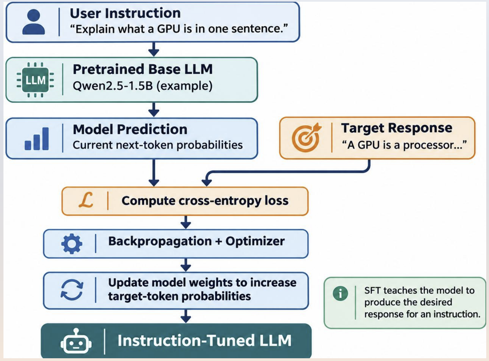</p>

---

<!-- 29페이지 -->

## 사전 학습된 언어 모델의 유형

### PLM(Pretrained Language Model, 사전 학습된 언어 모델)

특정 작업에 맞게 조정되기 전에, 대량의 텍스트로 학습하여 언어 패턴과 표현을 익힌 신경망이다.

### PLM의 세 가지 유형

- 인코더 전용 모델
- 디코더 전용 모델
- 인코더-디코더 모델

---

<!-- 30페이지 -->

### 인코더 전용 PLM

- ✓ 양방향 셀프 어텐션을 사용하여 모든 입력 토큰 사이의 관계를 이해한다.
- ✓ 주로 분류, 감정 분석, 개체명 인식과 같은 텍스트 이해 작업을 위해 설계되었다.

<p align="center">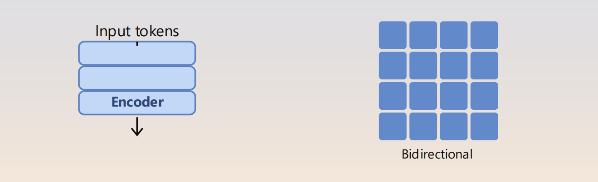</p>

---

<!-- 31페이지 -->

### 디코더 전용 PLM

- ✓ 인과적(마스킹된) 셀프 어텐션을 사용하여 각 토큰이 자기 자신과 이전 토큰에만 주의를 기울일 수 있도록 한다.
- ✓ 주로 자기회귀 텍스트 생성을 위해 설계되었으며, 현대의 생성형 LLM에서 널리 사용된다.

<p align="center">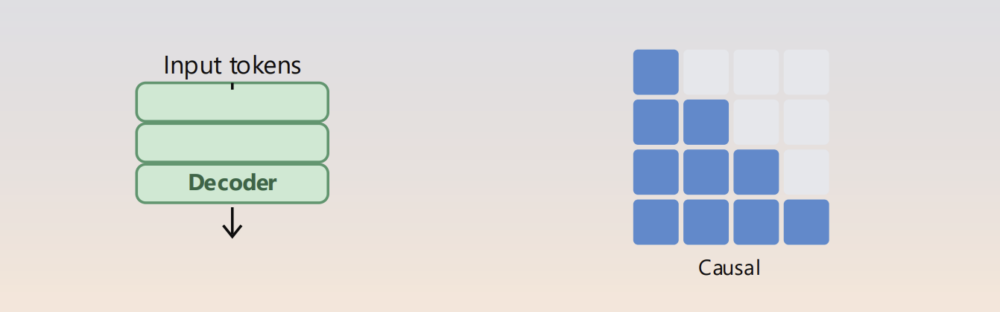</p>

---

<!-- 32페이지 -->

### 인코더-디코더 PLM

- ✓ 입력 이해를 위한 양방향 인코더와 출력 생성을 위한 인과적 디코더를 결합한다.
- ✓ 크로스 어텐션을 사용해 디코더를 인코더 출력과 연결한다. 번역 및 요약에 흔히 사용된다.

<p align="center">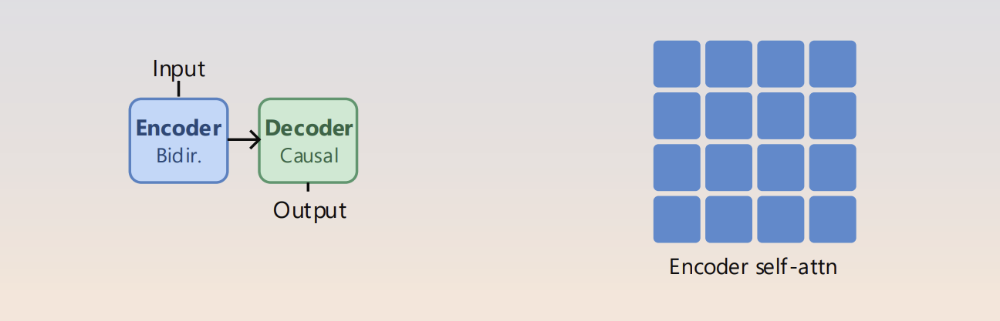</p>

---

<!-- 33페이지 -->

## 사전 학습된 언어 모델의 유형

| 특성 | 인코더 전용 | 디코더 전용 | 인코더-디코더 |
|---|---|---|---|
| 대표 모델 | BERT, RoBERTa | GPT, Llama, Qwen | T5, BART |
| 아키텍처 | 인코더 스택 | 디코더 스택 | 두 스택 모두 |
| 셀프 어텐션 | 양방향 | 인과적 | 양방향(인코더), 인과적(디코더) |
| 크로스 어텐션 | 없음 | 일반적으로 없음 | 있음 |
| 사전 학습 목표 | 마스킹 언어 모델링(MLM) | 다음 토큰 예측 | 시퀀스 간 노이즈 제거 |
| 주요 강점 | 텍스트 이해 | 텍스트 생성 | 입력에서 출력으로의 변환 |
| 일반적인 작업 | 분류, 개체명 인식(NER) | 채팅, 자동 완성, 생성 | 번역, 요약 |
| 출력 | 문맥적 표현 | 생성된 토큰 시퀀스 | 생성된 목표 시퀀스 |

---

<!-- 34페이지 -->

## PLM을 사용하는 두 가지 접근 방식

### 두 가지 사전 학습 접근 방식

- **특성 기반 접근 방식**
  - ✓ 내부 계층을 동결한다(업데이트하지 않는다).
  - ✓ 출력 표현(예: 단어 임베딩 또는 문맥 벡터)을 다른 모델의 특성으로 사용한다.
- **미세 조정 접근 방식**
  - ✓ 다운스트림 작업에서 내부 계층을 업데이트한다.

| 측면 | 특성 기반 | 미세 조정 |
|---|---|---|
| 모델 학습 | 동결된 사전 학습 모델 | 전체 모델(또는 대부분)을 업데이트 |
| 작업별 적응 | 낮음 | 높음 |
| 유연성 | 높음(다양한 파이프라인에서 활용 가능) | 중간(일반적으로 엔드투엔드 사용) |
| 계산 비용 | 낮음 | 높음 |
| 예시 모델 | ELMo | BERT, GPT |

---

<!-- 35페이지 -->

# 대규모 언어 모델

## - BERT -

트랜스포머의 양방향 인코더 표현(Bidirectional Encoder Representation from Transformers)

---

<!-- 36페이지 -->

## LLM의 기반: 아키텍처의 발전

### RNNLM

Mikolov가 만든 오픈 소스 신경망 언어 모델(NLM) 도구 모음.

*T. Mikolov 외, 「대규모 신경망 언어 모델 학습 전략」, 2011 IEEE 자동 음성 인식 및 이해 워크숍, IEEE, 2011, pp. 196–201.*

### RNN, LSTM, GRU

많은 자연어 응용 분야에서 널리 사용됨.

### 트랜스포머 아키텍처

신경망 언어 모델(NLM) 발전의 중요한 이정표.

문장이나 문서에 있는 모든 단어에 대해 어텐션 점수(각 단어가 다른 단어에 미치는 영향)를 병렬로 계산한다.

*A. Vaswani 외, 「어텐션만 있으면 된다」, 신경 정보 처리 시스템의 발전, 제30권, 2017.*

---

<!-- 37페이지 -->

## BERT - 트랜스포머의 양방향 인코더 표현

*Devlin 외, 2019*

### 주요 기여

- 자연어 처리(NLP)의 새로운 시대를 열었다.
- 깊은 트랜스포머 인코더에 기반한 미세 조정 접근 방식이다.
- 양방향 문맥을 바탕으로 표현을 학습한다(왼쪽과 오른쪽 문맥이 모두 중요하다!!).

  - 예시 #1: 우리는 강둑(bank)에 갔다.  
  - 예시 #2: 나는 예금하려고 은행(bank)에 가야 한다.

- 사전 학습 목표: 마스킹 언어 모델링 + 다음 문장 예측.
- 다양한 문장 수준 및 토큰 수준 작업에서 당시 최고 수준의 성능.
- 대규모 데이터셋으로 사전 학습된 모델은 다음에서 구할 수 있다: https://github.com/google-research/bert

---

<!-- 38페이지 -->

## BERT - 트랜스포머의 양방향 인코더 표현

Devlin 외, 2019

### BERT의 기반이 된 다섯 가지 주요 연구

- **반지도 시퀀스 학습(Semi-supervised Sequence Learning)** (Andrew Dai와 Quoc Le, 2015): LSTM의 비지도 사전 학습 후 지도 미세 조정을 수행하는 방식을 소개했다.
- **ELMo** (Matthew Peters와 AI2 및 UW CSE 연구진, 2018): 양방향 LSTM을 사용한 깊은 문맥적 단어 표현을 소개했다.
- **ULMFiT** (fast.ai 창립자 Jeremy Howard와 Sebastian Ruder, 2018): 언어 모델 사전 학습과 작업별 미세 조정을 통한 효과적인 전이 학습을 입증했다.
- **OpenAI GPT-1** (OpenAI 연구진 Radford, Narasimhan, Salimans, Sutskever): 단방향 트랜스포머를 사용한 생성적 사전 학습과 미세 조정을 입증했다.
- **트랜스포머(The Transformer)** (Vaswani 외, 2017): 셀프 어텐션을 소개하여 BERT의 아키텍처 기반을 제공했다.

---

<!-- 39페이지 -->

### 마스킹 언어 모델링

- 양방향 문맥을 학습하는 적절한 방식.
- 입력 토큰 중 $k\%$를 마스킹한 다음, 마스킹된 토큰을 예측한다.

  ```text
  그 남자는 우유 한 [MASK]을 사려고 [MASK]에 갔다.
                  가게            갤런
  ```

- **마스킹 비율($k$)**:
  - 전통적으로 15%로 설정했다(*Devlin 외, 2019*).
  - 마스킹이 너무 적으면: 학습 속도가 느리다(표본 비효율적).
  - 마스킹이 너무 많으면: 정확하게 예측할 수 있을 만큼의 문맥이 남지 않는다.
  - 최근 연구 결과: Wettig 외(2022)는 15%가 최적이 아닌 경우가 많으며, 더 높은 마스킹 비율(예: 30%~40%)이 더 좋은 성능을 보이는 경우가 많다는 것을 보여 주었다.
- 더 최적화된 방법은 구간 마스킹(*Span masking, Joshi 외, 2020*)과 PMI 마스킹(*Levine 외, 2021*)을 참고한다.

---

<!-- 40페이지 -->

- **구간 마스킹(SpanBERT)**
  - ✓ 개별 단어를 마스킹하는 대신, 연속된 토큰 구간을 한 번에 마스킹한다.

  ```text
  원문: 오늘 날씨가 매우 맑고 나는 기분이 좋다.
  일반 MLM: 오늘 [MASK]가 매우 맑고 나는 기분이 좋다.
  구간 마스킹: 오늘 [MASK] 나는 기분이 좋다.
  → [MASK] = "날씨가 매우 맑고"
  ```

- **PMI(점별 상호 정보량) 마스킹**
  - ✓ PMI 점수가 높은, 즉 의미적으로 연관된 단어 쌍을 마스킹한다.

  ```text
  문장: 그는 고양이와 개를 키운다.
  PMI가 높은 쌍: (고양이, 개)
  → 마스킹: 그는 [MASK]와 [MASK]를 키운다.
  ```

---

<!-- 41페이지 -->

### 마스킹 언어 모델링: 80-10-10 변형

- 예측 대상으로 선택한 15%의 단어에 대해:
  - ✓ **80%의 경우**, 해당 단어를 `[MASK]` 토큰으로 대체한다.

    ```text
    가게에 갔다 → [MASK]에 갔다
    ```

  - ✓ **10%의 경우**, 어휘 집합에서 무작위 단어로 대체한다.

    ```text
    가게에 갔다 → 달리기에 갔다
    ```

  - ✓ **10%의 경우**, 변경하지 않고 그대로 유지하지만 마스킹된 것처럼 예측하도록 한다.

    ```text
    가게에 갔다 → 가게에 갔다
    ```

**왜 변형을 적용하는가?**

1. 모델이 `[MASK]` 토큰에 지나치게 의존하지 않도록 방지한다.
2. 입력이 '정상적으로' 보일 때에도 BERT가 일반화하고 문맥적 임베딩을 학습하도록 장려한다.
3. 토큰 변형 유형에 관계없이 마스킹된 단어를 견고하게 예측하도록 돕는다.

---

<!-- 42페이지 -->

### 다음 문장 예측(NSP) - 분류 작업

- **동기**: 많은 NLP 다운스트림 작업은 두 문장 사이의 관계를 이해해야 한다(자연어 추론, 바꿔 쓴 문장 탐지, 질의응답).
- NSP는 사전 학습과 미세 조정 사이의 차이를 줄이기 위해 설계되었다.

`[CLS]`: 항상 맨 앞에 위치하는 특수 토큰

```text
입력 = [CLS] 그 남자는 [MASK] 가게에 갔다 [SEP] 그는 우유 한 갤런을 [MASK] [SEP]
레이블 = IsNext
```

`[SEP]`: 두 세그먼트를 구분하는 데 사용되는 특수 토큰

```text
입력 = [CLS] 그 남자는 가게에 [MASK] [SEP] 펭귄 [MASK]은 날지 못하는 새이다 [SEP]
레이블 = NotNext
```

---

<!-- 43페이지 -->

## BERT - 트랜스포머의 양방향 인코더 표현

- 어휘 집합 크기: 30,000개 WordPiece (Wu 외, 2016)
- **드문 단어 / 어휘 집합에 없는 입력**: 처리에 실패하거나 `[UNK]` 토큰으로 매핑하는 대신, 속어 및 변형(`"taaaaasty"`), 철자 오류(`"laern"`), 형태적으로 복잡한 새로운 항목(`"Transformerify"`)을 인식 가능한 하위 단어 어근과 접미사로 자연스럽게 분해한다.

`[CLS]`: 항상 맨 앞에 위치하는 특수 토큰

<p align="center">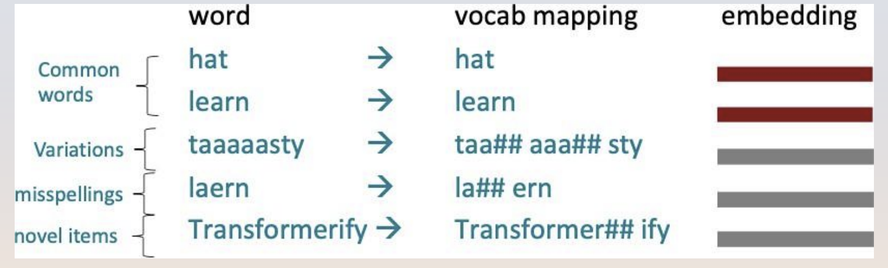</p>

빨간색 막대: 단일 토큰 임베딩을 나타낸다.  
회색 막대: 복합 임베딩을 나타낸다.

---

<!-- 44페이지 -->

## BERT - 트랜스포머의 양방향 인코더 표현

- **입력 임베딩**: 세 가지 임베딩의 합
  - **토큰 임베딩**: 개별 하위 단어 토큰을 연속적인 벡터 공간으로 매핑한다.
  - **세그먼트 임베딩**: 토큰이 어느 문장에 속하는지를 나타내기 위해 학습 가능한 임베딩 벡터(\(E_A\) 또는 \(E_B\))를 할당하여 문장 쌍 작업(NSP 또는 NLI 등)을 해결한다.

---

<!-- 45페이지 -->

## BERT - 트랜스포머의 양방향 인코더 표현

- 인코더 전용
- **BERT-base**: 12개 계층, 은닉 크기 768, 12개 어텐션 헤드, 1억 1천만 개 파라미터.

  OpenAI GPT와 동일함

- **BERT-large**: 24개 계층, 은닉 크기 1024, 16개 어텐션 헤드, 3억 4천만 개 파라미터.
- **학습 말뭉치**: 위키백과(25억) + BooksCorpus(8억)

  OpenAI GPT는 BooksCorpus로만 학습되었다.

- **최대 시퀀스 크기**: 512개 WordPiece(연속되지 않는 두 시퀀스에 대해 대략 256개와 256개)
- **학습**: 100만 스텝(약 40에포크), 배치 크기 131,072단어(1024개 시퀀스 × 길이 128 또는 256개 시퀀스 × 길이 512)

스텝은 일반적으로 하나의 데이터 배치를 처리한 후 수행하는 한 번의 파라미터 업데이트를 의미한다.

<p align="center">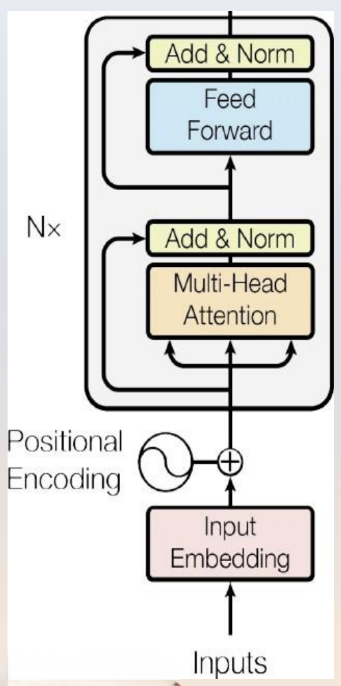</p>

---

<!-- 46페이지 -->

- **사전 학습**
  - ✓ MLM과 NSP를 함께 학습한다.
  - ✓ `[CLS]`는 NSP를 위해 사전 학습된다.
  - ✓ 다른 토큰 표현은 MLM을 위해 학습된다.

<p align="center">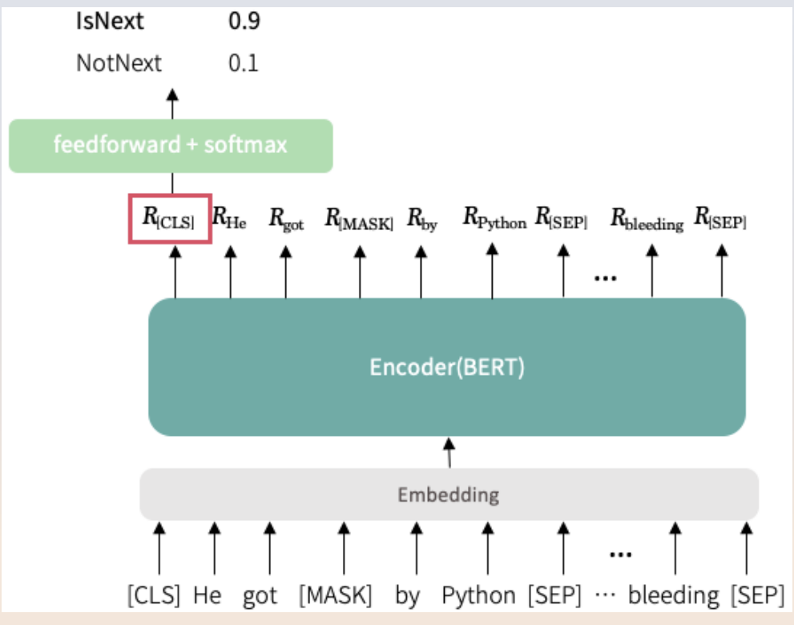</p>

---

<!-- 47페이지 -->

<p align="center">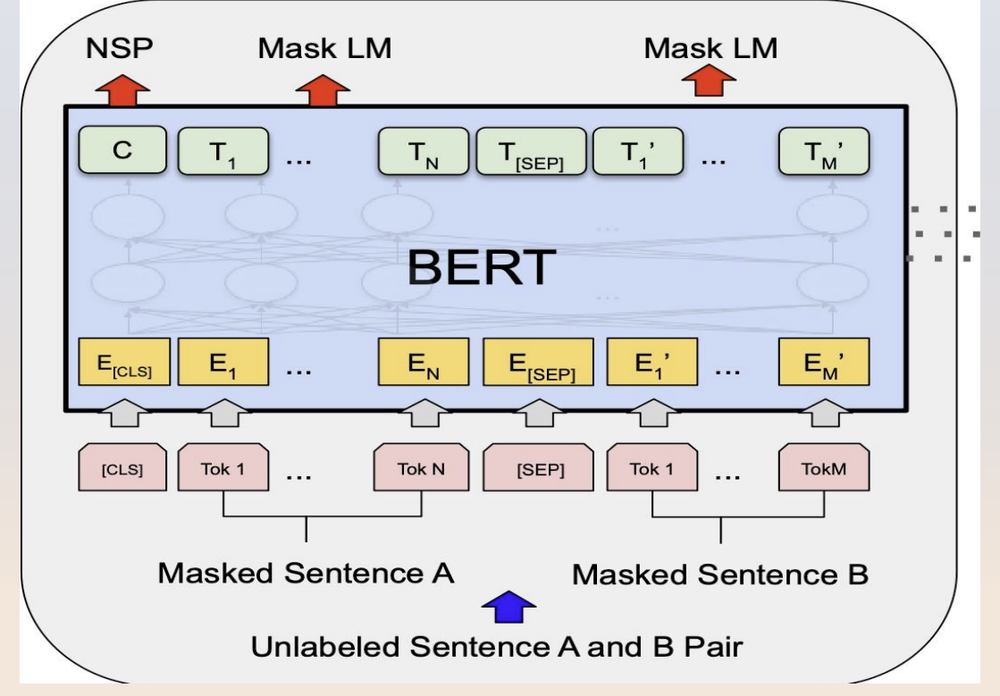</p>

---

<!-- 48페이지 -->

- **미세 조정**
  - ✓ 출력 계층을 제외하면 사전 학습과 미세 조정에 동일한 아키텍처를 사용한다.

<p align="center">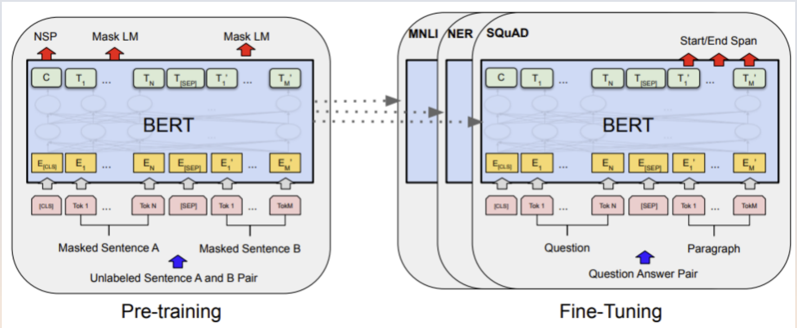</p>

---

<!-- 49페이지 -->

- **미세 조정(문장 수준 작업)**
  - ✓ 문장 쌍 분류 작업
  - ✓ 단일 문장 분류 작업

<p align="center">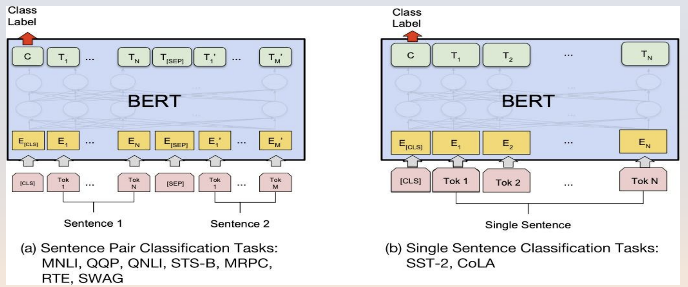</p>

---

<!-- 50페이지 -->

## BERT - 트랜스포머의 양방향 인코더 표현

(Wang 외, 2019): 6개 문장 쌍 작업과 2개 단일 문장 작업

- **GLUE(일반 언어 이해 평가)**
  - ✓ **MultiNLI(다중 장르 자연어 추론)**

    ```text
    전제: 여러 남성이 축구 경기를 하고 있다.
    가설: 몇몇 남성이 스포츠를 하고 있다.
    { 함의, 모순, 중립 }
    ```

  - ✓ **QQP(Quora 질문 쌍)** - 두 질문이 같은 것을 묻는가?

    ```text
    Q1: 주식 투자를 어디서 배울 수 있나요?
    Q2: 주식에 관해 어떻게 더 배울 수 있나요?
    { 중복, 중복 아님 }
    ```

  - ✓ **SST2(스탠퍼드 감정 트리뱅크)**

    ```text
    이 영화에는 재미있는 부분이 풍부하다.
    { 긍정, 부정 }
    ```

---

<!-- 51페이지 -->

- **미세 조정(토큰 수준 작업)**
  - ✓ 질의응답 작업
  - ✓ 단일 문장 태깅 작업

<p align="center">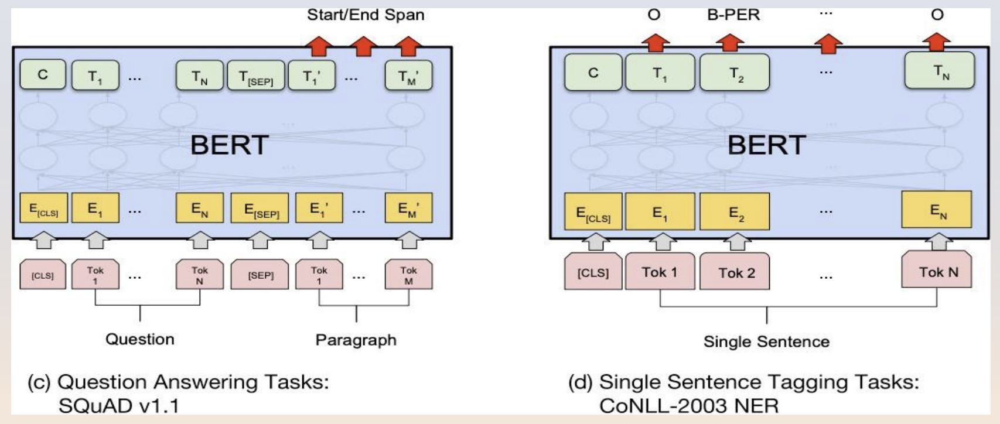</p>

---

<!-- 52페이지 -->

- **추출형 질의응답** (Rajpurkar 외, 2016)
  - ✓ **SQuAD(스탠퍼드 질의응답 데이터셋)**

    ```text
    문맥: 아폴로 계획은 NASA가 수행한 미국의 세 번째 유인 우주 비행 계획으로,
          최초로 인간을 달에 착륙시키는 데 성공했다.
    질문: 최초로 인간을 달에 착륙시킨 계획의 이름은 무엇인가?
    답: 아폴로 계획
    ```

- **개체명 인식** (Tjong Kim Sang와 De Meulder, 2003)
  - ✓ **CoNLL 2003 NER(2003년 계산 자연어 학습 학회)**

    ```text
    John  Smith  lives  in  New  York.
    B-PER I-PER  O      O   B-LOC I-LOC
    ```

    - PERSON: 사람 이름
    - ORGANIZATION: 기업, 기관
    - LOCATION: 지명
    - DATE: 날짜, 시간
    - MONEY: 금액
    - PERCENT: 백분율

---

<!-- 53페이지 -->

- **BERT가 무엇을 학습했으며 어떻게 동작하는가.**
  - ✓ 통사적 지식, 의미적 지식, 세계 지식...
  - ✓ 어떻게 마스킹할 것인가, 무엇을 마스킹할 것인가, 어디를 마스킹할 것인가, 마스킹의 대안

<p align="center">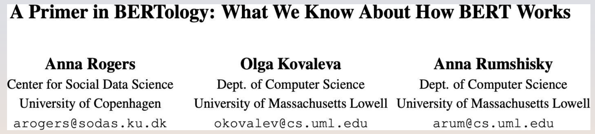</p>

---

<!-- 54페이지 -->

- **BERT 이후에는 어떤 일이 있었는가?**

- **RoBERTa** (Liu 외, 2019)
  - ✓ 10배 많은 데이터로 더 오래 학습했고, NSP를 사용하지 않는다.
  - ✓ BERT보다 훨씬 강력한 성능(예: SQuAD에서 94.6 대 90.9).
  - ✓ 현재까지도 가장 인기 있는 모델 중 하나이다.

- **ALBERT** (Lan 외, 2020)
  - ✓ 계층 간 모델 파라미터를 공유하여 모델 크기를 늘렸다.
  - ✓ 더 적은 저장 공간, 훨씬 강력한 성능을 제공하지만 실행 속도는 더 느리다.

- **ELECTRA** (Clark 외, 2020)
  - ✓ 토큰의 15% 대신 100%를 예측함으로써 더 효율적인 학습 방법을 제공한다.

- **XLM** (Lample와 Conneau, 2019)
  - ✓ 병렬 데이터에 번역 언어 모델링(TLM)을 도입하여 BERT를 교차 언어 사전 학습으로 확장한다.

---

<!-- 55페이지 -->

- **BERT 이후에는 어떤 일이 있었는가?**

- **긴 문맥(512개 토큰)을 처리하는 모델**
  - ✓ Longformer, Big Bird, ...

- **다국어 BERT**
  - ✓ 위키백과의 104개 언어를 단일 모델로 학습했고, 11만 개의 WordPiece 어휘 집합을 공유한다.

- **다양한 분야로 확장된 BERT**
  - ✓ SciBERT, BioBERT, FinBERT, ClinicalBERT, ...

- **사용을 위해 BERT를 더 작게 만드는 방법**
  - ✓ DistillBERT, TinyBERT, ...
