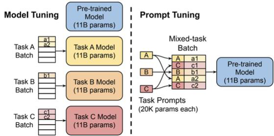
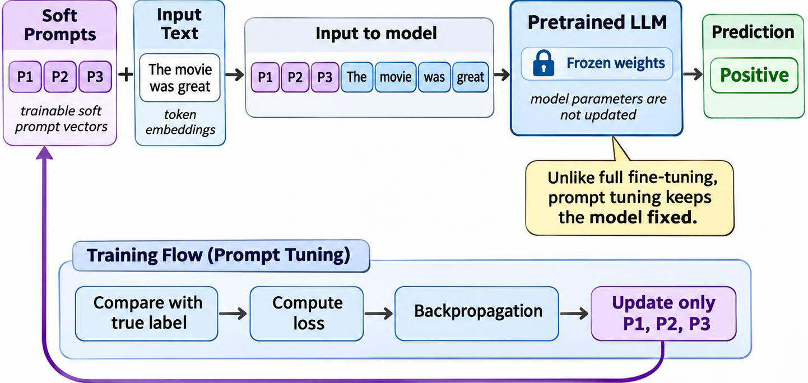
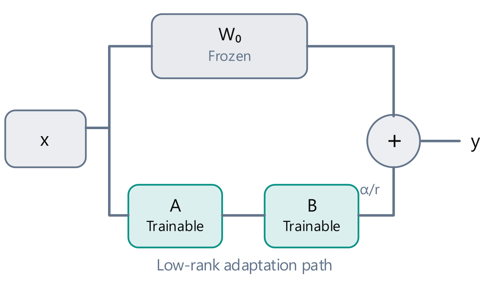
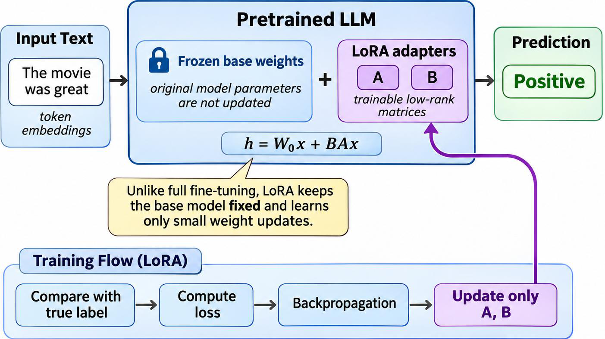
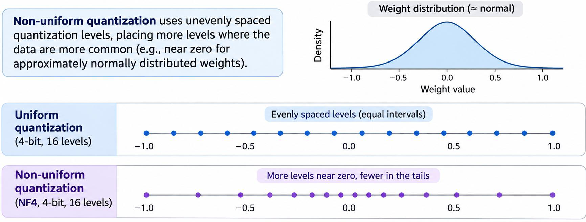
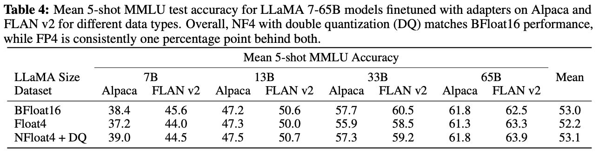

<!-- 09_LLM.pdf 2페이지에서 추가 -->

# N-gram의 문제점

1. 데이터 희소성(Data sparsity) → 단어 임베딩(Word Embedding)
2. 고정된 문맥 윈도우(Fixed context window) → RNN/LSTM
3. 장거리 의존성(Long-range dependency) → Attention
4. 순차 계산 병목(Sequential computation bottleneck) → Transformer
5. 대규모 사전 학습(Large-scale pretraining) → LLM

---

<!-- 2페이지 -->

# LLM 미세 조정(Fine-Tuning)

---

<!-- 3페이지 -->

## 미세 조정(Fine-Tuning)의 개념

### 정의

사전 학습된 모델을 가져와 선별된 도메인 특화 데이터셋으로 추가 학습하여, 특정 작업, 페르소나 또는 스타일에 맞게 가중치를 조정하는 과정.

---

<!-- 4페이지 -->

## LLM 학습 생명주기

### 현대 언어 모델은 세 단계의 생명주기를 거친다

1. **사전 학습(Pretraining)**
   - 웹 말뭉치
   - 기본 지식
2. **SFT/Instruct**
   - 선별된 질의응답
   - 지시 이행
3. **정렬(Alignment)**
   - RLHF / DPO
   - 안전성 및 선호도

- **사전 학습(Base Models)**: 문장을 완성하지만, 대화하거나 지시를 안정적으로 따르지는 못한다.
- **지도 미세 조정(Supervised Fine-Tuning, SFT / Instruct Models)**: 기본 모델을 질의응답 또는 멀티턴 대화 데이터셋으로 학습한다. 이를 통해 단순한 텍스트 완성 모델을 어시스턴트로 바꾼다.
- **도메인 특화 미세 조정(이 강의의 초점)**: Instruct 모델을 가져와 자체 작업에 맞게 미세 조정한다. 예를 들어, 엄격한 Cambridge 밴드별 평가 기준에 따라 IELTS 에세이를 평가하도록 한다.

---

<!-- 5페이지 -->

## 왜 미세 조정을 하는가?

좋은 프롬프트를 사용해 GPT-4나 Claude 같은 강력한 모델에 작업을 요청하면 되는데, 왜 시간, 돈, 연산 자원을 들여 더 작은 AI 모델을 맞춤화하는가?

- **엄격한 스타일 및 페르소나 일관성**: 프롬프팅은 긴 문맥에서 종종 "드리프트(drift)"가 발생하거나 설정된 캐릭터를 벗어난다. 미세 조정은 페르소나를 모델의 가중치에 직접 하드코딩한다.
- **복잡한 출력 형식**: 미세 조정된 모델은 취약한 재시도 루프 없이도 정확한 스키마를 안정적으로 출력한다.
- **엣지 하드웨어에서의 성능**: 소형 7B 또는 8B 모델을 미세 조정하여, 특정 전문 분야의 작업에서 70B 이상의 범용 모델과 대등하거나 더 나은 성능을 내도록 할 수 있다.
- **데이터 프라이버시 및 거버넌스**: 가중치가 공개된 모델(open-weight model)을 미세 조정하면 기업은 모든 민감한 고객 데이터를 자체 Virtual Private Cloud(VPC) 또는 로컬 컴퓨터 안에 보관할 수 있다.

---

<!-- 6페이지 -->

- **프롬프트 압축 및 지연 시간 감소**: 제로샷 프롬프팅에서는 매 API 요청마다 평가 기준, 지시문, 퓨샷 예시로 이루어진 2,000개 토큰을 전송해야 할 수 있다. 미세 조정은 이러한 지시를 모델에 내재화하여 입력 프롬프트 길이를 최대 80% 줄이고, 지연 시간과 추론 비용을 크게 줄인다.

**예시**: 정리되지 않은 고객 지원 이메일에서 정보를 추출하고 맞춤형 감정 분석을 수행하여, 엄격한 JSON 형식으로 출력하는 AI 도구를 개발하고 있다고 하자.

---

<!-- 7페이지 -->

### 기업용 API의 토큰 프롬프트

````text
[시스템 지시문 - 약 400개 토큰]
당신은 "CloudScale Enterprise"의 전문 고객 지원 분류 봇입니다.
들어오는 이메일을 분석하고, 분류하고, 계정 ID를 추출하여, 엄격하게 지정된 형식의 JSON을 출력하는 것이 당신의 역할입니다.
```json과 같은 마크다운 블록을 절대 포함하지 말고, JSON만 그대로 출력하세요. 계정 ID가 없으면 null로 설정하세요.
감정 점수는 -5부터 5까지의 정수여야 합니다.

[평가 기준 / 정의 - 약 600개 토큰]
- 범주 1: "Billing" - 청구서, 신용카드, 구독 업그레이드, 환불에 적용됩니다.
- 범주 2: "Outage" - 서버 중단, 500 오류, API 타임아웃에 적용됩니다.
- 범주 3: "Account" - 비밀번호 재설정, 권한 변경, SSO 설정에 적용됩니다.
- 감정 척도:
  -5: 극심한 분노, 서비스 이탈 위협, 법적 조치.
  -3부터 -1: 답답함, 조급함, 업무가 막힘.
  0: 중립적, 단순한 질문.
  1부터 5: 칭찬, 만족.

[퓨샷 예시 - 약 800개 토큰]
예시 1:
입력: "저기요, 프로덕션 서버에서 20분 동안 504 오류가 발생하고 있어요! 당장 고쳐 주세요. 고객들이 몹시 화가 났어요. 계정: ACC-9941."
출력: {"category": "Outage", "account_id": "ACC-9941", "sentiment": -4, "action_required": "즉시 상위 담당자에게 전달"}

예시 2:
입력: "지난달 청구서를 보내 주실 수 있나요? 감사합니다!"
출력: {"category": "Billing", "account_id": null, "sentiment": 1, "action_required": "영수증 보내기"}

[... 이와 같은 예시가 3개 더 있다고 생각해 보세요 ...]

[실제 사용자 입력 - 약 200개 토큰]
입력: "안녕하세요. 다음 달부터 엔터프라이즈 요금제에 사용자 라이선스 3개를 추가해야 합니다. 어떻게 하면 되나요?"
````

### 자체 API의 토큰 프롬프트

```text
입력: "안녕하세요. 다음 달부터 엔터프라이즈 요금제에 사용자 라이선스 3개를 추가해야 합니다. 어떻게 하면 되나요?"
```

---

<!-- 8페이지 -->

## 학습 데이터는 얼마나 필요한가?

- **형식 및 스타일을 위한 경우**(예: "항상 이 스키마와 일치하는 엄격한 JSON을 출력하라"):
  - ✓ 데이터셋 크기: 보통 200~1,000개의 예시가 가장 적절하다.
  - ✓ 양보다 품질이 중요하다: 세심하게 작성된 완벽한 입력/출력 쌍 200개가, 복사해 붙여 넣은 정돈되지 않은 로그 5,000개보다 언제나 더 낫다.
- **전문 도메인 작업을 위한 경우**(예: 의료비 청구 코딩, 자체 내부 API 변환):
  - 데이터셋 크기: 1,000~10,000개 이상의 예시.
  - 모델이 전혀 새로운 도메인 어휘나 이전에 본 적 없는 복잡한 논리를 학습해야 한다면, 충분한 데이터 규모와 여러 에포크(epoch)가 필요하다.

---

<!-- 9페이지 -->

### 위험 구간(과적합, Overfitting)

에포크 수를 너무 높게 설정하면(예를 들어, 데이터를 20회 반복 학습하면), AI는 일반적인 규칙을 학습하는 것을 멈추고 데이터셋을 단어 하나하나 그대로 무작정 외우기 시작한다.

이렇게 되면 실제 환경에서 새롭고 조금 다른 질문이 주어졌을 때 크게 실패한다. 이를 과적합(overfitting)이라고 한다. **보통 2~4에포크가 가장 적절하다.**

---

<!-- 10페이지 -->

## 전체 파라미터 미세 조정(Full Parameter Fine-Tuning)

**전체 미세 조정은 모델의 모든 학습 가능한 파라미터를 업데이트한다.**

이 방식은 모델을 조정하는 데 상당한 유연성을 제공하지만, 많은 GPU 메모리가 필요하다.

1.5B 모델이 16비트 가중치와 기울기를 사용하고, 두 개의 32비트 상태 텐서를 유지하는 Adam 계열 옵티마이저를 사용한다고 가정하자.

| 메모리 구성 요소 | 대략적인 요구량 |
|---|---|
| 모델 가중치 | 3.1 GB |
| 기울기 | 3.1 GB |
| 두 개의 FP32 옵티마이저 상태 | 12 GB |
| 소계 | 18.2 GB |
| 활성값(activations), 임시 버퍼, 그리고 경우에 따라 마스터 가중치(master weights) | 1.5 GB ~ 4 GB |

**GPU 메모리를 많이 소비한다.**

---

<!-- 11페이지 -->

## 파라미터 효율적 미세 조정(Parameter-Efficient Fine-Tuning, PEFT)

### PETF 방법

- **선택적 방법(Selective Methods)**:
  - 미세 조정할 파라미터의 일부를 선택한다.
- **재매개변수화 방법(Reparameterization Method)**:
  - 모델 가중치를 저랭크(low-rank)로 표현한다.
  - 예: LoRA
- **추가적 방법(Additive Methods)**:
  - 모델에 학습 가능한 계층이나 파라미터를 추가한다.
  - 예: Adapters, Soft prompts(Prompt Tuning)

---

<!-- 12페이지 -->

## 프롬프트 튜닝(Prompt Tuning)

**Prompt Tuning** (Lester 외, 2021):

사전 학습된 모델의 파라미터를 동결한 채, 소수의 soft prompt 임베딩을 학습하여 사전 학습된 언어 모델을 다양한 작업에 맞게 조정한다.

<p align="center"></p>

---

<!-- 13페이지 -->

1. 사전 학습된 언어 모델을 동결한다.
2. 각 작업에 대해 학습 가능한 소수의 soft prompt 벡터를 도입한다.
3. 이 벡터들을 입력 임베딩 앞에 붙인다.
4. 작업별 데이터를 사용하여 프롬프트 벡터만 학습한다.

Soft prompt 벡터는 사전 학습된 LLM이 특정 작업을 수행하도록 유도하는 학습 가능한 임베딩 벡터이다.

- **Hard prompt**: "감정을 분류하세요:"
- **Soft prompt**: $P = [0.21, -0.45, 0.78, 0.13]$

---

<!-- 14페이지 -->

## Prompt Tuning - 예시

### 감정 분류 예시

작업: 영화 리뷰를 긍정 또는 부정으로 분류한다.

<p align="center"></p>

---

<!-- 15페이지 -->

## LoRA

**저랭크 적응(Low Rank Adaptation, LoRA)** (Hu 외, Microsoft Research, 2022):

큰 가중치 행렬을 업데이트하는 대신, 작은 행렬 두 개를 학습한다.

$$
y = Wx, \qquad W \in \mathbb{R}^{d \times k}
$$

일반적인 미세 조정에서는

$$
W_{\mathrm{new}} = W_0 + \Delta W
$$

$W_0$: 사전 학습된 행렬, $\Delta W$: 학습된 조정값

LoRA는 효과적인 가중치 조정을 저랭크 분해(low-rank decomposition)로 근사할 수 있다고 가정한다.

$$
\Delta W = BA
$$

$$
A \in \mathbb{R}^{r \times k}, \qquad B \in \mathbb{R}^{d \times r}
$$

여기서 $r$은 입력 및 출력 차원보다 훨씬 작다.

---

<!-- 16페이지 -->

이에 따른 순전파 계산은 다음과 같다.

$$
y = W_0x + \frac{\alpha}{r}BAx
$$

- $W_0$: 동결된 사전 학습 가중치
- $A, B$: 학습 가능한 LoRA 파라미터
- $r$: LoRA 랭크(rank), $r \ll \min(d, k)$
- $\alpha$: 스케일링 하이퍼파라미터

<p align="center"></p>

**Full Rank**: $n \times n$ 정사각행렬의 랭크가 $n$이면 full rank라고 한다.

**Low Rank**: 랭크가 행렬의 실제 차원보다 훨씬 작은 경우.

---

<!-- 17페이지 -->

## LoRA - 작업 흐름

### 감정 분류 예시

작업: 영화 리뷰를 긍정 또는 부정으로 분류한다.

<p align="center"></p>

---

<!-- 18페이지 -->

## LoRA - 메모리 절약

### 학습되는 파라미터는 몇 개인가? (예시)

다음 Transformer 가중치 행렬을 생각해 보자.

$$
W_0 \in \mathbb{R}^{768 \times 768}
$$

LoRA 랭크가 $r = 8$일 때:

$$
A \in \mathbb{R}^{8 \times 768}, \qquad B \in \mathbb{R}^{768 \times 8}
$$

| 방법 | 이 계층의 파라미터 수 |
|---|---|
| 전체 미세 조정 | 589,824 |
| LoRA (rank 8) | 12,288 |
| **감소량** | **학습 가능한 파라미터 97.9% 감소** |

---

<!-- 19페이지 -->

## LoRA - 적절한 적용 위치

> 이 부분에서 교수님께서 시험 얘기 하심

### Qwen2.5에서 LoRA는 어디에 적용되는가?

LoRA는 일반적으로 각 Transformer 디코더 블록 내부의 Self-Attention 계층에 있는 가중치 행렬에 적용된다.

### Qwen2.5에서 LoRA를 적용할 가중치 (빨간색은 권장 적용 대상)

Self-Attention: <span style="color: red;">Query</span>, Key, <span style="color: red;">Value</span>, Output 투영 행렬.

MLP: Gate, Up, Down 투영 행렬을 포함한다.

이 모델에는 28개의 Transformer 디코더 블록이 있으므로, 각 블록의 `q_proj`와 `v_proj`에 LoRA를 부착할 수 있다.

$$
Q = W_Qx + \frac{\alpha}{r}B_QA_Qx
$$

$$
V = W_Vx + \frac{\alpha}{r}B_VA_Vx
$$

이 구성($r = 8$)에서 예상되는 학습 가능한 LoRA 파라미터 수: **1,089,536**

---

<!-- 20페이지 -->

### 어떤 계층을 선택해야 하는가?

| 구성 | target_modules | 권장 사항 |
|---|---|---|
| 최소 구성 | `q_proj`, `v_proj` | 첫 단계에 가장 적합 |
| Attention만 | `q_proj`, `k_proj`, `v_proj`, `o_proj` | 유연한 Attention 조정 |
| Attention + MLP | 일곱 가지 투영 유형 모두 | 더 높은 조정 능력, 더 높은 메모리 비용 |

**Q와 V가 최적이라는 이론적 보장은 없다.**

---

<!-- 21페이지 -->

### GPT-3 (175B)의 실험 결과

| LoRA 적용 대상 가중치 | Rank | WikiSQL | MultiNLI |
|---|---|---|---|
| $W_Q$만 | 8 | 70.4 | 91.0 |
| $W_K$만 | 8 | 70.0 | 90.8 |
| $W_V$만 | 8 | 73.0 | 91.0 |
| $W_O$만 | 8 | 73.2 | 91.3 |
| $W_Q, W_K$ | 4 | 71.4 | 91.3 |
| $W_Q, W_V$ | 4 | 73.7 | 91.3 |
| $W_Q, W_K, W_V, W_O$ | 2 | 73.7 | 91.7 |

---

<!-- 22페이지 -->

## QLoRA

### 4-bit NormalFloat (NF4)

4비트(16가지 가능한 값)만 사용하는 양자화 기법.

**핵심 아이디어**: LLM 가중치는 대체로 근사적인 정규분포(종 모양)를 따르므로, NF4는 이 분포에 최적화된 비균일 양자화(non-uniform quantization) 수준을 사용한다.

<p align="center"></p>

---

<!-- 23페이지 -->

## QLoRA

### QLoRA = 양자화된 사전 학습 LLM + LoRA

QLoRA는 4비트 기본 모델과 저랭크 어댑터(Low-rank Adapters)를 사용하여 16비트 전체 미세 조정의 성능을 재현할 수 있다.

<p align="center"></p>
